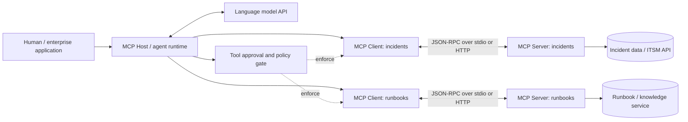
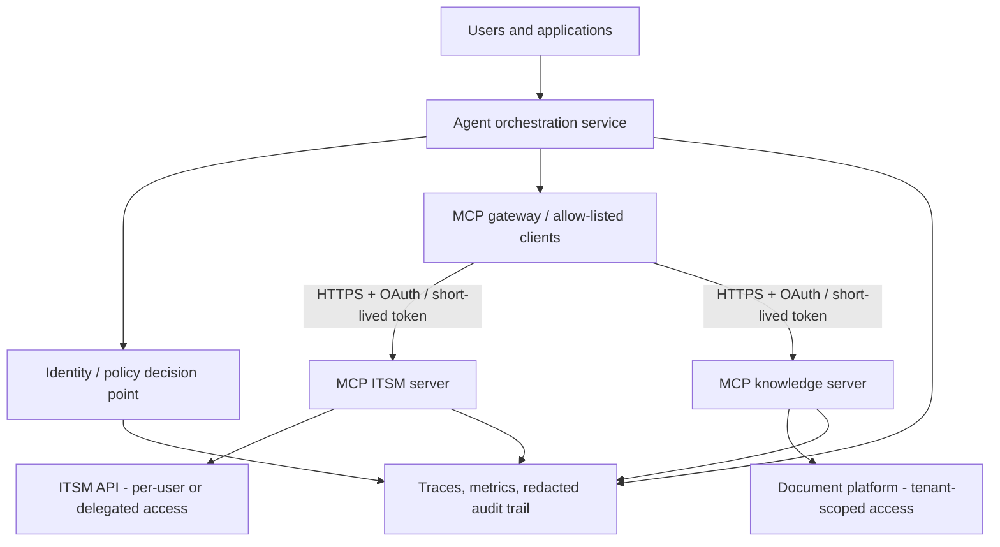
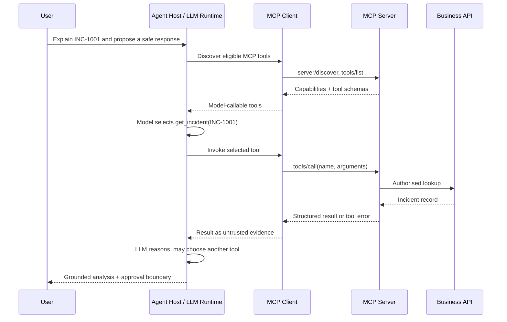
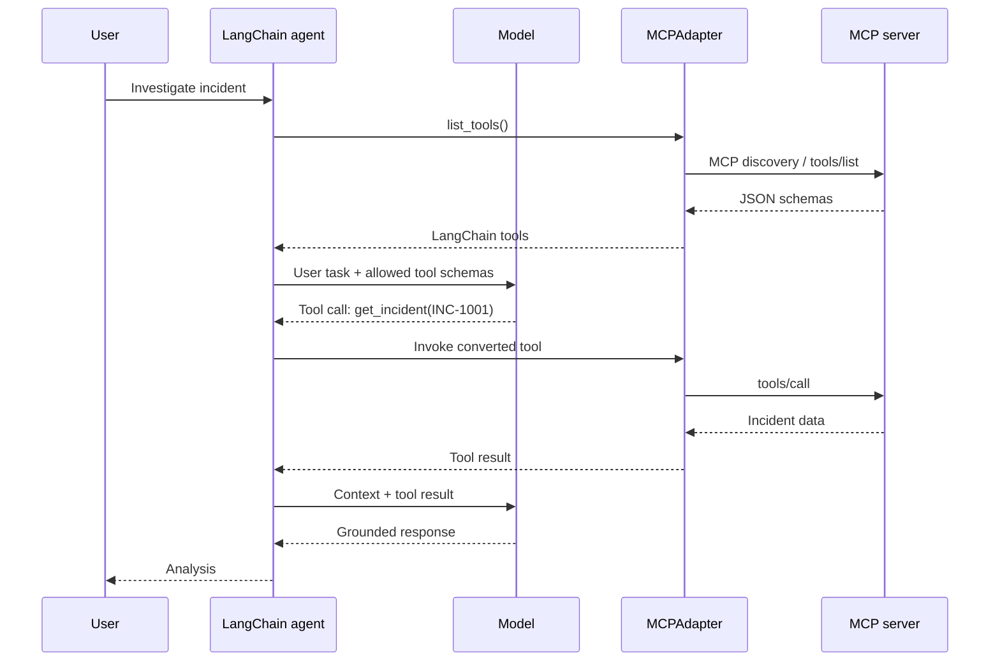
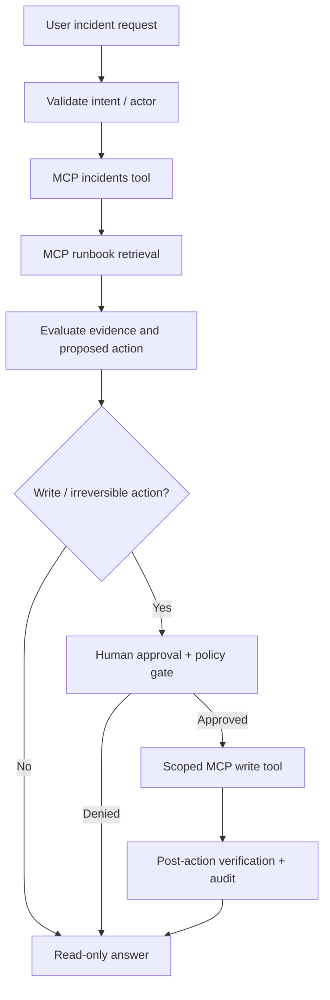

# Model Context Protocol (MCP): Architecture, Server Engineering and Agent Integration

**Intermediate technical workshop | Duration: 120 minutes | Audience: AI engineers, solution architects, platform engineers, agentic AI developers**  
**Prepared: 12 November 2026 | Baseline: MCP specification `2026-07-28` | Language: Python 3.11+**

> **Version note.** This workshop deliberately targets the newer MCP specification and official Python SDK v2. You will also learn to recognise the 2025-era, handshake/session-based design because some production servers, blog examples and older clients still use it. The workshop's LangChain examples use `langchain.mcp.MCPAdapter`, introduced in the 2026 integration, rather than the legacy `langchain_mcp_adapters.client.MultiServerMCPClient` API. SDK code examples are based on published APIs, but dependency installation and a model-backed end-to-end run could not be verified in the preparation environment; see the verification statement in `README.md`.

## 1. Workshop outcomes and prerequisites

### Learning outcomes
By the end, participants should be able to:

1. Explain **MCP host**, **MCP client**, **MCP server**, a model provider, and the underlying enterprise APIs without confusing their responsibilities.
2. Draw the logical and deployment architectures for one-agent/many-server designs, and map trust boundaries.
3. Describe MCP's **data layer** and **transport layer**, including JSON-RPC 2.0 messages, tool schemas, capability discovery, errors, cache hints and transport constraints.
4. Implement **tools**, **resources**, **resource templates** and **prompts** with the official MCP Python SDK.
5. Connect a non-LLM MCP client to a server, inspect discoverable capabilities, and invoke a tool safely.
6. Integrate a LangChain agent with one MCP server and then two independent servers.
7. Evaluate tool poisoning, prompt injection, authorisation, confused-deputy risks, auditability, human approval and safe production deployment.
8. Explain major changes in the **2026-07-28** revision: stateless per-request metadata, `server/discover`, header-based routing, cacheable list results, MRTR and extension-based tasks.

**Prerequisite knowledge:** Python async basics, decorators, type hints, JSON APIs, HTTP, OAuth concepts, LLM function/tool calling, and introductory LangChain/LangGraph. No knowledge of MCP internals is assumed.

**Required software:** Python 3.11+, virtual environment or `uv`, terminal and editor. Optional: Node.js for MCP Inspector; OpenAI API key for agent demonstrations. The no-LLM protocol lab does **not** need an API key.

### Suggested two-hour delivery plan

| Time | Duration | Segment | Instructor demonstration / participant output |
|---|---:|---|---|
| 00:00–00:10 | 10 min | MCP problem statement and system boundaries | Contrast API integration, tool calling and MCP |
| 00:10–00:25 | 15 min | Reference architecture and data flow | Draw host → client → servers → business systems |
| 00:25–00:40 | 15 min | Primitives and JSON-RPC internals | Inspect tool schemas, error and resource responses |
| 00:40–00:55 | 15 min | Protocol revisions, transport, lifecycle, security envelope | Compare 2025 and 2026 flow; reason about HTTP headers |
| 00:55–01:00 | 5 min | Break | Setup verification |
| 01:00–01:20 | 20 min | Lab 1: design and implement MCP servers | Run `incident_server.py`; inspect tools/resources/prompts |
| 01:20–01:35 | 15 min | Lab 2: protocol-level client and transport | Run `client_inspect.py` over stdio and local HTTP |
| 01:35–01:50 | 15 min | Lab 3: agent integration and orchestration | Run single-server and two-server agents |
| 01:50–01:58 | 8 min | Security, observability and production architecture | Review threat scenarios and deployment gates |
| 01:58–02:00 | 2 min | Homework and exit question | Assign exercise and grading rubric |
| **Total** | **120 min** | | |

**Facilitator guidance:** The security and deployment sections below are more comprehensive than can be discussed in eight minutes. Assign them as pre-reading or use them during Q&A. Treat live agent inference as a demonstration, not a strict timing dependency: model latency and tool retries vary.

---

## 2. What problem does MCP solve? (00:00–00:10)

A traditional AI agent integration has two coupled pieces: (1) the model's provider-specific tool schema and (2) bespoke Python/JavaScript glue that authenticates to each enterprise API. An agent connecting to a CRM, ticketing system, Git provider, vector store and database often needs separate adapters, documentation, retry logic, access controls and lifecycle management.

**MCP standardises the interface between an AI application and external context/capabilities.** A server advertises named operations and context through a discoverable protocol. The host/client manages the connection, exposes relevant capabilities to the model and presents the results to the application. The protocol does **not** itself decide which tool to invoke, reason about an answer, approve an action or replace backend authorisation.

```text
Without MCP                                     With MCP
------------                                    --------
Agent A -- custom connector --> Service X        AI Host / Agent A -- MCP Client --+
Agent A -- custom connector --> Service Y                                      | 
Agent B -- custom connector --> Service X                              +-------+-------+
                                                                    MCP Server X  MCP Server Y
                                                                     Service X     Service Y
```

**Distinguish five interfaces:**

| Layer | Contract | Responsibility |
|---|---|---|
| Model tool calling | LLM provider's message/tool schema | Model chooses a tool and arguments |
| MCP | JSON-RPC methods + server/client capabilities | Discovery, invocation, resource and prompt exchange |
| Enterprise API | REST/GraphQL/gRPC/SQL/etc. | Actual business operation or information retrieval |
| Orchestrator | LangChain/LangGraph or custom agent runtime | Multi-step planning, state, retries, HITL, policy |
| Governance | Identity, policy engine, audit logs, approvals | Decide **whether** a capability may execute |

**The important boundary:** MCP is the interoperability layer. An agent runtime is still responsible for orchestration, and the enterprise is still responsible for authorisation and risk controls. MCP server credentials must not silently become an agent's unlimited authority.

**Opening question:** If an agent can directly call a Python function, why use MCP? Expected answers: interoperability between hosts, language-neutral discovery, remote deployment, clear surface boundaries, independent service ownership and reusable tool contracts. Trade-offs include added protocol hops, new attack surfaces, discovery complexity and operational controls.

---

## 3. MCP reference architecture (00:10–00:25)

### 3.1 Logical host–client–server architecture



In this drawing, each server relationship is an independent logical MCP client. The host may manage multiple clients, choose which tools to surface to the model and consolidate results. The server does not own the chat UI or decide the user's enterprise entitlements.

**Host:** Provides user-facing interaction, model orchestration, consent/approval UX and tool policy; may include an MCP client manager. **MCP client:** Manages the protocol relationship to a server, negotiates compatible versions and exposes discovered tools/resources/prompts to the host. **MCP server:** Implements MCP contracts and translates them into safe domain operations. **Backend systems:** Databases, APIs, SaaS platforms, code repositories, files, cloud telemetry, enterprise systems.

### 3.2 Deployment architecture for an enterprise



This is a **recommended implementation pattern**, not a topology mandated by the protocol. The gateway can centralise transport policy, token validation, allowlists and rate limits, but backend authorisation must still be enforced by each resource owner. No single gateway can substitute for database row-level access controls.

### 3.3 The agent-to-MCP sequence



In this workshop the data comes from **fictional, in-memory records** rather than live ITSM or knowledge APIs. The design makes it possible to demonstrate MCP without corporate credentials or accidental production changes.

### 3.4 Design implications

1. One host can attach to multiple independently deployed servers; servers do not need to know about one another.
2. Tool names should be unambiguous; when combining servers, use adapter-side namespace prefixes.
3. A tool schema is an interface contract, not a security boundary. Authorise the executed operation **on the server side**.
4. Resource content and tool results are **untrusted input** to a language model even if retrieved through an authenticated server.
5. Tool responses can be larger than the host's context window. Apply result size limits, summarisation and careful paging.

**Knowledge check:** Who decides whether `rollback_deployment()` is permitted? Answer: enterprise policy and/or an appropriately authorised human, enforced in the application and target system. The model merely proposes or requests a tool call.

---

## 4. MCP data model: tools, resources, prompts and client capabilities (00:25–00:40)

### 4.1 Three server primitives

| Primitive | Control model | Example | Discover/invoke methods | Key teaching point |
|---|---|---|---|---|
| **Tool** | Usually model-selected | `get_incident(incident_id)` | `tools/list`, `tools/call` | Executable operation; may read or write |
| **Resource** | Application-selected | `incident://severity-policy` | `resources/list`, `resources/read` | URI-addressed context; not automatically a model tool |
| **Resource template** | Application-selected | `incident://{incident_id}` | `resources/templates/list`, `resources/read` | Parameterised URI; static list differs from templates |
| **Prompt** | User/application-selected | `triage_brief(incident_id)` | `prompts/list`, `prompts/get` | Reusable message template, not an executable API |

A tool may return text, images or structured data. A schema typically describes `inputSchema` and may describe `outputSchema`; validating structured output improves client safety but does not guarantee the answer is true. A resource has a URI, optional MIME type and contents. A prompt produces a message or sequence of messages.

**Important:** A prompt being discoverable does not mean the LLM automatically receives or follows it. The host chooses when to surface a prompt or resource. In our agent demo, tools are automatically converted to LangChain tools; resources/prompts are intentionally demonstrated with the low-level client to make the distinction explicit.

### 4.2 Tool schema anatomy

The following is a **conceptual** `tools/list` item; exact optional fields may vary between SDKs and protocol revisions:

```json
{
  "name": "get_incident",
  "description": "Get a fictional incident by its exact ID",
  "inputSchema": {
    "type": "object",
    "properties": {
      "incident_id": {"type": "string", "description": "An ID such as INC-1001"}
    },
    "required": ["incident_id"],
    "additionalProperties": false
  }
}
```

A server with a typed Python function can generate the input schema from type annotations. That is convenient but only covers **shape**: checking that `incident_id` is a string is not the same as checking that this user is allowed to access incident `INC-1001`.

**Contract design checklist:** Prefer short verb-object names; parameter descriptions with allowed values; clear read/write semantics; deterministic outputs when possible; validation; explicit limits; idempotency keys for retries; and bounded error messages. Be wary of tools exposing arbitrary shell, arbitrary SQL, arbitrary URL fetch or unrestricted filesystem traversal.

### 4.3 JSON-RPC 2.0: an actual modern `tools/call` request

The `2026-07-28` revision uses JSON-RPC 2.0. A modern HTTP request includes the method/name headers and per-request metadata. The SDK generates these details; **do not handcraft them in ordinary application code**.

```http
POST /mcp HTTP/1.1
Host: 127.0.0.1:8000
Content-Type: application/json
Accept: application/json, text/event-stream
MCP-Protocol-Version: 2026-07-28
Mcp-Method: tools/call
Mcp-Name: get_incident
```

```json
{
  "jsonrpc": "2.0",
  "id": 41,
  "method": "tools/call",
  "params": {
    "name": "get_incident",
    "arguments": {"incident_id": "INC-1001"},
    "_meta": {
      "io.modelcontextprotocol/protocolVersion": "2026-07-28",
      "io.modelcontextprotocol/clientInfo": {"name": "training-client", "version": "1.0.0"},
      "io.modelcontextprotocol/clientCapabilities": {}
    }
  }
}
```

The result is associated with the same request ID. Under the 2026 revision successful final results carry `resultType: "complete"`. `resultType: "input_required"` indicates the interaction needs another round (see MRTR below). A JSON-RPC **protocol error** is distinct from an application/tool execution error: many tool errors are delivered as a normal `CallToolResult` with `isError: true`, rather than throwing a JSON-RPC exception. Check the client-side `result.is_error` in code.

### 4.4 Important method families

| Purpose | Examples |
|---|---|
| Capability discovery | `server/discover` in the latest protocol; older servers used `initialize` |
| Tool lifecycle | `tools/list`, `tools/call` |
| Resource lifecycle | `resources/list`, `resources/templates/list`, `resources/read` |
| Prompt lifecycle | `prompts/list`, `prompts/get` |
| Dynamic updates | `subscriptions/listen` in modern design, where implemented |
| Long-running work | Official Tasks **extension**, when negotiated and implemented |
| Mid-call user interaction | MRTR `InputRequiredResult` / elicitation |

MCP also defines optional utilities such as argument completion, progress and cancellation. A feature's existence in the standard does not guarantee every host/server supports it; check capabilities. **Sampling and roots are deprecated in the July 2026 revision**; legacy implementations may still expose them. The new spec discourages building fresh server-side LLM invocation on deprecated sampling.

### 4.5 Tool vs resource vs prompt: incident scenario

**Question:** A user says: “Explain how we classify critical incidents, then investigate INC-1001.” A correct host may first read `incident://severity-policy` as context, invoke `get_incident` as an operation, and optionally offer `triage_brief` as a reusable prompt. It should not assume that a read-only severity policy resource is automatically visible to the model merely because an MCP client connected.

---

## 5. Lifecycle, transport and the 2026 protocol changes (00:40–00:55)

### 5.1 Data layer versus transport layer

**Data layer:** JSON-RPC methods, discoverable capabilities, input/output schemas, metadata, result objects, error semantics and notifications. **Transport layer:** How these messages move, including local process stdio or remote Streamable HTTP.

**Stdio:** The host launches a subprocess. Each protocol message flows over standard input/output. Best for local trusted tools, desktop integrations, demos and sandboxed single-user workflows. **Never write ordinary logs to stdout** while serving stdio; use stderr or a logging facility. The subprocess may receive only an allowlisted environment; explicitly provide required credentials where needed, rather than assuming it inherits the shell's entire environment.

**Streamable HTTP:** An MCP endpoint receives POST requests over HTTP(S). For `2026-07-28`, the server can return JSON or a request-scoped SSE stream, while longer-lived subscriptions use `subscriptions/listen`. The revision removed the legacy GET stream and protocol-level session IDs. Bind local demos only to `127.0.0.1`; use authenticated TLS and origin validation for any production endpoint. The older HTTP+SSE transport should not be selected for new implementations.

| Decision | Stdio | Streamable HTTP |
|---|---|---|
| Process model | Local child process | Network-reachable service |
| Typical use | Laptop/IDE, developer tools | Multi-tenant cloud/service integration |
| Identity | Launch context, local policy, explicitly supplied credentials | OAuth/token verification + server-side authorisation |
| Scalability | Usually host-process limited | Load-balanced replicas, infrastructure policies |
| Security focus | Process privilege, executable trust, filesystem | TLS, origin, token scope, gateway/WAF, tenant isolation |
| In demo | `client_inspect.py` | `incident_server.py --http` and `agent_http.py` |

### 5.2 Old and new protocol behaviour

| Concern | 2025-era design | 2026-07-28 design |
|---|---|---|
| Start of relationship | `initialize` then `notifications/initialized` | Self-describing calls; optional `server/discover` |
| Core model | Connection/session oriented | Stateless request/response core |
| Version and capabilities | Exchanged during handshake | Sent per request in `_meta` |
| Remote session ID | Could use `Mcp-Session-Id` | Removed from current Streamable HTTP core |
| HTTP server-initiated updates | GET and stream patterns | Request-scoped stream or `subscriptions/listen` |
| Mid-tool request for input | Server-initiated request on connection | MRTR `input_required` then replay with inputs |
| Catalog caching | Client dependent | Standard `ttlMs` and `cacheScope` hints |
| Routing support | Parse JSON body or transport-specific policies | `Mcp-Method`, `Mcp-Name`; optional `Mcp-Param-*` headers |
| Long operations | Experimental tasks patterns | Official negotiated Tasks extension |

**Compatibility matters:** A v2 SDK's high-level `Client` can negotiate with an older server. Do not assume every package called `FastMCP` uses the same Python import path; the official Python SDK v2 renamed its high-level server class to `MCPServer`, while the separate FastMCP library remains a distinct project.

### 5.3 Per-request metadata and header mirroring

The 2026 protocol requires `_meta` values `io.modelcontextprotocol/protocolVersion` and `io.modelcontextprotocol/clientCapabilities` on each request; client identity metadata is recommended. HTTP also requires `MCP-Protocol-Version`, `Mcp-Method`, and `Mcp-Name` where appropriate. A gateway can route or meter by method/name rather than parse arbitrary bodies. Gateways must enforce that mirrored headers match the body; otherwise the headers can be spoofed. Schema annotations may mirror explicitly selected primitive tool parameters into `Mcp-Param-*` headers.

**Caution:** MCP `clientInfo` is **self-reported diagnostic metadata**, not a verifiable user identity; do not use it for authorisation. Identity comes from authenticated and verified credentials and enterprise policy.

### 5.4 Multi Round-Trip Requests (MRTR)

An MCP tool may need human input (for example, a choice of region or confirmation of a proposed action). Under MRTR, the server responds with an interim `InputRequiredResult` containing `inputRequests`. The client obtains the answers, then retries the original operation with `inputResponses`. This avoids tying such interaction to a permanently open bidirectional session. The high-level Python client can drive these rounds for supported callbacks.

**Do not confuse elicitation with approval:** An elicitation mechanism provides the interaction channel; enterprise policy still determines whether a human approval is necessary, what authority that human has and how the audit evidence is persisted.

### 5.5 Caching, subscriptions and tasks

Modern list/read responses can include TTL and cache-scope hints to reduce repeated catalog loading. A cache must still be partitioned by user/tenant/entitlement as applicable: never reuse a privileged catalog or resource result in the wrong principal context. Notifications can announce changing tool/resource catalogs, while subscriptions are opt-in. A genuinely long-running data export or batch job may fit the Tasks extension: return an operation handle and poll/obtain status rather than block indefinitely; **extension negotiation** is required.

**Discussion:** If a client caches `tools/list` and the server silently adds a new `delete_accounts` tool, is that safe? No. Review tool-catalog changes, enforce an allowlist, and do not grant new write capability merely because discovery returned it.

---

## 6. Lab setup and project walkthrough (01:00–01:20)

### 6.1 Files supplied

```text
MCP_Server_Intermediate_Workshop/
├── 01_MCP_2_Hour_Intermediate_Workshop.md   # This complete session
├── 02_Homework_MCP_Enterprise_Agent.md      # Participant assignment
├── README.md                                # Quickstart and validation status
├── requirements.txt                        # MCP SDK v2 + LangChain
├── .env.example
├── code/
│   ├── incident_data.py                    # Fictional domain data, pure logic
│   ├── incident_server.py                  # MCP server A; stdio + HTTP
│   ├── runbook_server.py                   # MCP server B; stdio
│   ├── client_inspect.py                   # Official non-LLM MCP client
│   ├── agent_single.py                    # Single-server LangChain agent
│   ├── agent_multi.py                     # Two-server LangChain agent
│   └── agent_http.py                      # Agent over HTTP MCP
└── tests/
    ├── test_domain.py                     # Dependency-free unit tests
    └── test_mcp_inprocess.py              # In-memory protocol integration tests
```

### 6.2 Install and test

From the workshop root directory:

```bash
python3 -m venv .venv
source .venv/bin/activate                  # Windows: .venv\Scripts\activate
python -m pip install -r requirements.txt
python -m unittest discover -s tests -p 'test_domain.py' -v
python -m unittest discover -s tests -p 'test_mcp_inprocess.py' -v
```

The installed SDK must support `from mcp.server import MCPServer`, `from mcp import Client` and `from langchain.mcp import MCPAdapter`. If these fail, inspect package versions with `python -m pip show mcp langchain` and ensure you did not install a legacy SDK or shadow a package with a local `mcp.py` filename. For reproducibility, freeze tested versions in your classroom environment.

### 6.3 What the server implements

`incident_server.py` demonstrates:

- `@mcp.tool()` with typed inputs and structured return values.
- `@mcp.resource("incident://severity-policy")` for an application-selected policy document.
- `@mcp.resource("incident://{incident_id}")` for URI template-based access.
- `@mcp.prompt()` for an argument-driven triage message.
- `mcp.run(transport="stdio")` by default; `--http` uses `streamable-http` on localhost.

**Annotated excerpt:**

```python
from mcp.server import MCPServer

mcp = MCPServer("enterprise-incidents")

@mcp.tool()
def get_incident(incident_id: str) -> dict:
    """Read one incident by an exact ID."""
    return get_incident_record(incident_id)  # Domain validation occurs here

@mcp.resource("incident://severity-policy")
def severity_policy() -> str:
    return "SEV1: critical; SEV2: major; SEV3: contained."

if __name__ == "__main__":
    mcp.run(transport="stdio")
```

This is a **teaching excerpt**; the actual runnable server contains additional tools, real demo records and `--http` handling. Read its full source. The SDK maps function signatures to schema, but the domain layer must validate identifiers and business rules.

### 6.4 Instructor live demo: Inspector

The MCP Inspector is useful for viewing tools, schemas, resources and invocation results. With Node.js and the MCP CLI extra installed, one common path is:

```bash
python -m pip install 'mcp[cli]>=2,<3'
mcp dev code/incident_server.py
```

If the Inspector is not installed or cannot launch in a locked-down classroom, use `client_inspect.py` below. The GUI is **not** a dependency for the lab.

**Expected output:** Three incident tools (`list_incidents`, `get_incident`, `get_incident_metrics`), one static resource (`incident://severity-policy`), one templated incident resource and one prompt (`triage_brief`). Check templates separately from concrete resource listing.

**Two-minute hands-on change:** Add a new read-only tool `get_service_owner(service: str) -> str` with an allowlisted service mapping. Reconnect the client and prove the newly discovered tool is visible. Explain why this change needs a catalog governance review in production.

---

## 7. Lab 2: Build a real MCP client, without an LLM (01:20–01:35)

### 7.1 Why use a protocol client before an agent?

This isolates protocol correctness from model variability. If an agent fails, determine whether the server is discoverable, the schema is valid, the tool executes, the adapter exposes it, or the model chose not to call it. Avoid debugging all layers simultaneously.

### 7.2 The high-level MCP Python client

```python
from mcp import Client
from mcp.client.stdio import StdioServerParameters

async with Client(StdioServerParameters(
    command="python", args=["code/incident_server.py"]
)) as client:
    tools = await client.list_tools()
    result = await client.call_tool("get_incident", {"incident_id": "INC-1001"})
    if result.is_error:
        raise RuntimeError(result.content)
```

The client opens a subprocess and negotiates the supported protocol version. The full `code/client_inspect.py` additionally lists resources and prompts, reads a resource and obtains the prompt text. In the v2 SDK, `Client(server_object)` also permits **in-process** test connections without a network listener, as shown in `tests/test_mcp_inprocess.py`.

### 7.3 Execute over stdio

```bash
python code/client_inspect.py
```

Look for the negotiated protocol version, three tools, severity resource, prompt template and returned details of `INC-1001`.

### 7.4 Execute over Streamable HTTP

Terminal A:

```bash
python code/incident_server.py --http
```

Terminal B:

```bash
python code/client_inspect.py --http
```

The endpoint is `http://127.0.0.1:8000/mcp`, deliberately loopback-only and unauthenticated for **training**. It is not a production deployment recipe. Modern SDK clients add the necessary HTTP headers, version metadata and response handling automatically.

### 7.5 Observe error handling

Change the client call to `INC-9999` or a bad severity. Expected: the tool's input or domain validation fails and the result is marked as an error rather than producing invented incident details. Keep transport failures, JSON-RPC protocol errors, tool errors and *semantic hallucinations* separate in the incident taxonomy:

| Symptom | Likely layer | Recommended instrumentation |
|---|---|---|
| Server process fails immediately | Subprocess/import | stderr, startup health and environment |
| HTTP 401/403 | Transport/authorisation | Auth logs, actor, scopes, audience |
| Method or version mismatch | MCP protocol | Server/client version and headers |
| `is_error == true` | Domain tool | Tool ID, validated arguments and safe error code |
| Tool succeeds but agent makes unsupported claim | Agent/model | Tool provenance, evaluations, output checks |

---

## 8. Lab 3: Connect agents to MCP servers (01:35–01:50)

### 8.1 Architecture: tools become model-callable capabilities



The **adapter** converts MCP tool descriptions into the agent framework's tool objects. The adapter does not remove the need for tool restrictions, message size control or safety review.

### 8.2 Single MCP server agent

`code/agent_single.py` follows this pattern:

```python
from pathlib import Path
from langchain.agents import create_agent
from langchain.mcp import MCPAdapter

async with MCPAdapter(Path("code/incident_server.py")) as adapter:
    tools = await adapter.list_tools()
    agent = create_agent(
        model="openai:gpt-4.1-mini",
        tools=tools,
        system_prompt="Use incident facts; do not make production changes."
    )
    response = await agent.ainvoke({"messages": [
        {"role": "user", "content": "Investigate INC-1001."}
    ]})
```

Execute the **actual file** from the project root (it resolves paths robustly, checks the API key, enforces a recursion bound and includes stronger model instructions):

```bash
export OPENAI_API_KEY='your_api_key'          # Windows PowerShell: $env:OPENAI_API_KEY='...'
python code/agent_single.py
```

Set `MCP_DEMO_MODEL` to another installed/provider-supported model name if appropriate. A model-backed run costs provider tokens; do not share API keys in classroom submissions or screenshots.

### 8.3 Multi-server agent

`code/agent_multi.py` creates **two isolated servers** via MCP config and exposes both tool catalogs to one LangChain agent:

```python
import sys
from langchain.mcp import MCPAdapter
from langchain.agents import create_agent

config = {
    "mcpServers": {
        "incidents": {"command": sys.executable, "args": ["code/incident_server.py"]},
        "runbooks": {"command": sys.executable, "args": ["code/runbook_server.py"]},
    }
}

async with MCPAdapter(config) as adapter:
    tools = await adapter.list_tools()  # Tool names are prefixed by server name
    agent = create_agent(model="openai:gpt-4.1-mini", tools=tools)
```

This snippet is schematic: use the full file for absolute paths, an explicit system prompt, key checks and execution. Run:

```bash
python code/agent_multi.py
```

**Expected reasoning chain:** The agent uses the incidents server to retrieve `INC-1001`, extracts its service and symptoms, searches the runbooks server, reads the relevant runbook such as `RB-PAY-01`, then provides diagnostics and approval-gated remediation options. The exact tool order and wording are model dependent; inspect the discovered tool list and agent traces rather than assuming deterministic reasoning.

**Key architecture concept:** This is *agent-to-many-MCP-servers*, not *MCP-server-to-MCP-server* orchestration. Multi-step logic lives in the agent runtime. A single MCP server should encapsulate one clear capability boundary rather than trying to own an entire autonomous workflow by default.

### 8.4 HTTP-connected agent

With `incident_server.py --http` running, execute:

```bash
python code/agent_http.py
```

The only difference visible to the agent is the adapter's server target (`http://127.0.0.1:8000/mcp` instead of local process/path). The exposed tool contract remains comparable, while authentication and deployment change substantially in real systems.

### 8.5 Where LangGraph fits

`create_agent` is implemented on a graph-based orchestration foundation, but a more complex enterprise agent might explicitly model separate states and nodes:



Use explicit LangGraph nodes/interrupts when you require durable checkpoints, human authorisation, controlled retries, conditional branching, separation of planning/execution or recovery after failure. MCP only standardises the external tool interface; it does not give you reliable workflow state by itself.

**Participant question:** If a model asks a read-only tool to `get_incident("INC-1001")` three times, what are possible causes? Model uncertainty, tool result truncation, lack of caching, poor instructions, or retry loops. Mitigate through clear schemas, bounded steps, caching where valid and trace inspection.

---

## 9. Security, governance, reliability and operations (01:50–01:58 plus recommended pre-reading)

### 9.1 MCP trust boundaries

```text
Untrusted user input    Untrusted tool descriptions/results    Untrusted external documents
         |                          |                               |
         +--------------------------+-------------------------------+
                                    |
                              Agent runtime
                                    |
                       Tool allowlist + policy gate
                                    |
                              MCP client
                                    |
                      Identity-bearing credentials
                                    |
                           MCP server validation
                                    |
                    Enterprise API / DB enforcement
```

**Principle:** Treat instructions from tool descriptions, search results, retrieved documents and even server metadata as untrusted relative to application policy. A valid MCP message is not evidence that its content is safe to obey.

### 9.2 Threat-to-control matrix

| Threat | Example | Technical control |
|---|---|---|
| Prompt injection | Incident note says “ignore your instructions” | Mark external data as untrusted; restrict tools; test adversarial cases |
| Tool poisoning | Server description orders the agent to exfiltrate data | Pin and review server/catalog changes; tool allowlists; schema approval |
| Confused deputy | Server uses service account to read records outside user's scope | Propagate requester identity; enforce resource-level access; avoid blanket service privileges |
| Excessive permissions | Agent has a broad write token for read-only analysis | Least privilege, task-specific scopes, just-in-time grants |
| Data exfiltration | Agent sends private values to a permitted external URL | Egress controls, DLP, allowlisted domains, data-class policy |
| Cross-server escalation | One server's content influences calls to a stronger server | Independent scopes, server-level trust tiering, output isolation |
| Replay/duplicate writes | Network retry repeats a payment or change | Idempotency keys, durable action records, no blind retries |
| SSRF/file exposure | Arbitrary fetch/file tools reach internal hosts | No arbitrary targets, sandbox, URL/path validation, network policy |
| Supply-chain compromise | Unreviewed MCP package gains host permissions | Provenance, dependency scanning, signed artifacts, sandboxed subprocess |
| Leaky logs | Payload contains access tokens or customer data | Redaction, role-limited access, retention and encryption |

### 9.3 Authorisation is more than authentication

For remote HTTP servers: validate TLS, token issuer/audience/expiry, delegated/user scopes and underlying resource access. Follow the MCP authorisation specification, including relevant OAuth discovery and token-handling requirements. For local stdio: enforce executable trust, environment allowlisting, filesystem boundaries and controlled subprocess privileges. Never pass a general-purpose cloud admin credential to a third-party MCP server.

**Two enforcement checkpoints:** (a) the host decides whether a tool is eligible to be called; (b) the MCP server and backend independently verify authority before touching data. The host's “You are not allowed to delete” system prompt is not an access control.

For every write tool, define **actor**, **resource**, **action**, **scope**, **approval rule**, **idempotency key**, **result/rollback condition** and **audit record**. The demo deliberately exposes **no write tools**; adding them is the participants' controlled-design challenge in the homework.

### 9.4 Logging and evaluation

Collect request/trace ID, user or service principal, MCP server name/version, tool name, tool-call outcome, latency, truncated/sanitised parameters, prompt/model revision, approval identity and backend response code. Avoid recording full secrets, customer records or unnecessary prompt content. Modern MCP supports propagation of OpenTelemetry `traceparent`, `tracestate` and `baggage` metadata.

**Recommended operational service-level indicators (SLIs):**

- Tool-call success/error rates by MCP server and tool.
- p50/p95/p99 end-to-end latency, separating LLM reasoning and tool backend latency.
- Argument validation failures, auth denials, timeouts and rate-limit events.
- Cache hit ratio and catalog/schema mismatch incidents.
- Grounded-answer rate, source attribution quality and task completion rate.
- Unsafe tool-call proposal rate, approval bypass attempts and cross-tenant access violations.

**Reliability budget:** Bound agent steps, tool-call timeouts, retries and concurrency. For write tools, retries must be idempotent or explicitly approved. Use circuit breakers for faulty downstream APIs, rate limits at tool and principal level, and fallback to a partial answer rather than fabricating unavailable information.

### 9.5 Readiness gates for production

A server is **not** enterprise ready merely because the Inspector can invoke it. Suggested release gates:

1. Published owner and purpose; versioned contract and compatibility test.
2. Reviewed schemas and limited tool catalog; no arbitrary privileged execution.
3. OAuth/token controls for HTTP, least privilege, tenant/resource authorisation and audited approvals.
4. Prompt-injection and tool-poisoning tests, DLP/egress controls and sandboxing.
5. Timeouts, idempotency, input/output bounds, rate limiting and observability.
6. Data classification and retention assessment; incident response, rollback and decommissioning plan.
7. Tool/agent eval suite covering correct tool selection, argument validity and evidence-grounded conclusions.

**Critical architecture lesson:** You can build a standards-compliant MCP server that is still insecure. Compliance with the protocol and assurance of an enterprise workflow are independent review dimensions.

---

## 10. Instructor demo script and exit assessment

### Demo scripts, by layer

**Step 1 — Baseline:** Run `python -m unittest discover -s tests -p 'test_domain.py' -v`; show that domain functions work without MCP. **Step 2 — MCP exposure:** Open `incident_server.py`, identify tools/resource/prompt decorators and explain schema derivation. **Step 3 — Protocol:** Run `client_inspect.py`, read the discovered tools and prompt, then make a bad-ID call and inspect `is_error`. **Step 4 — Transport:** Start local HTTP and repeat the client call with `--http`; contrast deployment/security boundaries. **Step 5 — Agent:** Run `agent_single.py`; then `agent_multi.py`. Draw where the model chooses the next tool. **Step 6 — Security:** Ask whether a runbook sentence can authorise a production rollback. It cannot.

### Four exit questions with ideal answers

**Q1.** Is an MCP server the same as an LLM agent?  
**A1.** No. It exposes a protocol-bound capability; an agent orchestrates model decisions and tool calls.

**Q2.** How is a resource different from a tool?  
**A2.** A resource is an application-selected URI-addressed context object; a tool is an executable function usually eligible for model-directed invocation.

**Q3.** What changed in the July 2026 protocol revision?  
**A3.** Stateless per-request core and metadata, `server/discover`, no protocol-level HTTP sessions, modern header routing, MRTR and cache hints, among other changes.

**Q4.** Can the LLM grant itself access to a tenant's incidents by choosing an MCP tool?  
**A4.** No. Server-side and backend authorisation enforce the requesting principal's access regardless of model intent.

---

## 11. Beyond the 120 minutes: technical extensions for self-study

1. **Explicit state and LangGraph interrupts:** Maintain an action proposal object, pause at approval, resume with a signed decision and execute only on a valid matching scope.
2. **Remote OAuth/MCP gateway:** Attach a verified audience-bound access token; prove a principal without the required scope receives a denial; validate that same-tenant roles see different data.
3. **Structured-output contracts:** Define and validate output schemas; compare model-grounded accuracy before and after structured results.
4. **Cache isolation tests:** Verify resources/catalogs are not reused across principals; test expired TTL and catalog updates.
5. **Long-running tasks:** Implement the Tasks extension only after verifying client capability support and operational status persistence.
6. **Protocol compatibility matrix:** Test a modern client against both 2026 and legacy 2025 servers, recording negotiated versions and error semantics.
7. **Load and failure injection:** Simulate stale resources, malformed arguments, slow upstream services and retryable versus non-retryable errors.
8. **Evaluations:** Build a fixed benchmark of 20 incident questions to score tool-choice accuracy, evidence citations, hallucination rate, latency and unsafe action proposals.

## 12. Homework handoff

**Homework title:** *Build a governed Enterprise Incident Copilot using two MCP servers.* Full specification, acceptance tests, deliverable structure and the 100-point grading rubric are in `02_Homework_MCP_Enterprise_Agent.md`. The homework is an **individual hands-on build**, not a slide-only submission.

**Minimum submission:** two functioning MCP servers, one model-backed agent connecting to both, unit/protocol tests, architecture diagram, security controls and README with reproducible steps. Advanced credit for human approval, strict principal scoping, HTTP auth and adversarial evaluation. **No real production credentials, endpoints or customer records should be used.**

---

## 13. Reference material and currency notes

The following primary/maintainer sources informed the workshop. Some examples online remain anchored to older MCP SDKs; prioritise the named protocol revision and verify installed package versions.

1. [Model Context Protocol — 2026-07-28 release announcement](https://blog.modelcontextprotocol.io/posts/2026-07-28/) — protocol changes, stateless core and extensions.
2. [MCP protocol specification — Overview](https://github.com/modelcontextprotocol/modelcontextprotocol/blob/main/docs/specification/2026-07-28/basic/index.mdx) — JSON-RPC, metadata and result types.
3. [MCP 2026-07-28 changelog](https://github.com/modelcontextprotocol/modelcontextprotocol/blob/main/docs/specification/2026-07-28/changelog.mdx) — exact differences from the preceding version.
4. [MCP Streamable HTTP specification](https://github.com/modelcontextprotocol/modelcontextprotocol/blob/main/docs/specification/2026-07-28/basic/transports/streamable-http.mdx) — request headers, POST, response streams and security.
5. [Official MCP Python SDK](https://github.com/modelcontextprotocol/python-sdk) — `MCPServer` and v2 client patterns.
6. [Official Python SDK migration guide](https://github.com/modelcontextprotocol/python-sdk/blob/main/docs/migration.md) — server class rename, client changes and transport parameters.
7. [LangChain — MCP integration update (3 September 2026)](https://www.langchain.com/blog/mcp-in-langchain-stateless-protocol-elicitation-and-more) — native `langchain.mcp.MCPAdapter` integration.
8. [LangChain source documentation — MCP integration](https://github.com/langchain-ai/langchain/blob/master/openwiki/mcp-integration.md) — multi-server configuration, supported targets and tool mapping.
9. [OWASP MCP Security Cheat Sheet](https://cheatsheetseries.owasp.org/cheatsheets/MCP_Security_Cheat_Sheet.html) — prompt injection, poisoning, confused-deputy and defensive design.
10. [MCP security best practices](https://github.com/modelcontextprotocol/modelcontextprotocol/blob/main/docs/docs/2026-07-28/tutorials/security/security_best_practices.mdx) — official security considerations.

**Version/currency statement:** Written for the latest official MCP specification found as of 12 November 2026 (`2026-07-28`). Code syntax was cross-checked against published upstream references. Package installation and full MCP/LLM execution were unavailable in the authoring runtime due to restricted package-network access; only Python syntax checks and the dependency-free domain tests were executed locally. Run the included integration tests in a connected Python 3.11+ environment before classroom delivery.
